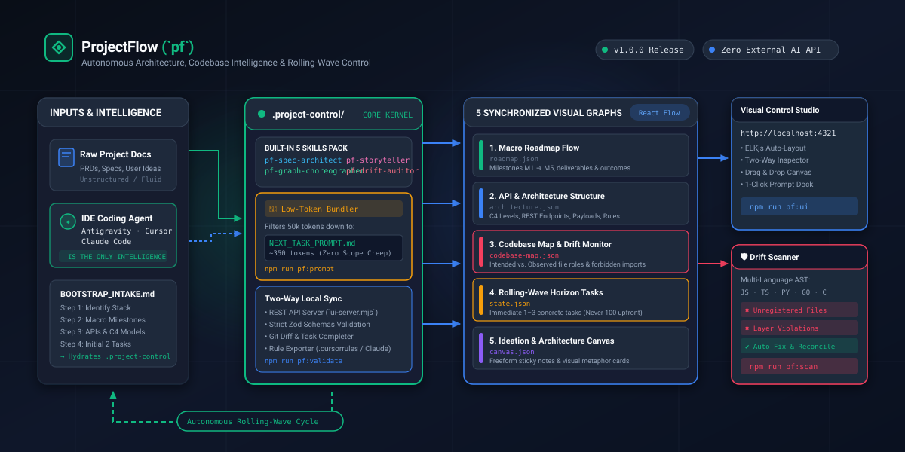

# ProjectFlow (`pf`)
### Visual Architecture, Codebase Intelligence & Rolling-Wave Control for Vibe Coding

[](https://github.com/seyedan0/PF-ProjectFlow/releases)
[](LICENSE)
[-F59E0B.svg?style=flat-square)](#-core-philosophy--architectural-principles)
[](#-built-in-default-skills-pack-agentsskills)

<p align="center">
  
</p>

---

## 🎯 Why ProjectFlow? (The Problem & Solution)

### The Problem with "Vibe Coding"
When building complex software with modern AI coding assistants (*Antigravity, Cursor, Claude Code*), projects inevitably face three severe failure modes:
1. **Loss of Architectural Visibility**: AI agents lack global architectural memory. Without a continuous visual model, modules become tangled spaghetti and team members lose sight of system boundaries.
2. **Context-Window Bloat**: Dumping 50-page PRDs or 100 premature static tasks into chat consumes thousands of tokens, confuses the model, and leads to hallucinations and scope creep.
3. **Silent Architecture Drift**: Agents claim "task complete", but covertly create unregistered files, violate forbidden layer boundaries (e.g., UI directly importing DB models), or bypass API contracts.

### The Solution: ProjectFlow (`pf`)
ProjectFlow introduces an autonomous governance and visual control harness inside your repository:
- **Embedded Single Source of Truth (`.project-control/`)**: 5 synchronized multi-layer JSON models governing roadmaps, APIs, file registries, rolling-wave tasks, and whiteboards.
- **Rolling-Wave Task Horizon**: Maintains a macro view of the entire lifecycle, but generates **only the next 1–3 concrete, atomic tasks** derived from completed history and current codebase state.
- **Zero External AI API Keys**: ProjectFlow does **NOT** require API keys (OpenAI/Anthropic). Your IDE agent **IS** the intelligence; `pf` provides the deterministic graph engine, AST scanner, and low-token context bundler.
- **Two-Way React Flow Studio**: A local browser UI (`http://localhost:4321`) with ELKjs auto-layout and two-way file synchronization—inspect nodes, drag whiteboards, and trigger agent actions.
- **Automated AST Codebase Scanner**: Multi-language static scanner inspecting physical source imports to red-flag architectural drift before it enters your git history.

---

## ⚡ 1-Minute Quick Start

### Option A: Agent Bootstrap Prompt (Recommended)
You do not need to manually configure files. Simply drop this prompt into **Antigravity**, **Cursor**, or **Claude Code** alongside your project specs or documentation:

```text
Clone or install ProjectFlow (https://github.com/seyedan0/PF-ProjectFlow) into this repository.
Read BOOTSTRAP_INTAKE.md and .agents/skills/project-flow/SKILL.md.
Analyze our project documentation/codebase and initialize .project-control/ with our Macro Roadmap, API & System Architecture, Codebase Map, and initial Rolling-Wave Tasks, then run `npm run pf:sync-rules`.
```

### Option B: Manual CLI Installation
To install the ProjectFlow toolkit and pre-built Visual Studio into any target project:

```bash
# Clone ProjectFlow or run directly from your local toolkit:
node path/to/project-flow/scripts/pf-install.mjs ./my-target-project

# Launch Visual Control Studio in your target project:
cd my-target-project
npm run pf:ui
```

---

## 🗺 The 5 Synchronized Visual Graph Layers

All architectural state is maintained inside `.project-control/` and rendered in the **Visual Control Studio**:

| Tab | State File | Visual Topology | Core Responsibility |
| :--- | :--- | :--- | :--- |
| **1. Macro Roadmap** | [`roadmap.json`](file:///.project-control/roadmap.json) | Left-to-Right Spine (`RIGHT` in ELKjs) | End-to-end lifecycle phases (`M1` to `M5+`), phase outcomes, target deliverables, and dependencies. |
| **2. API & Architecture** | [`architecture.json`](file:///.project-control/architecture.json) | Top-to-Bottom C4 Stratum (`DOWN` in ELKjs) | Subsystem modules, REST/GraphQL endpoints with request/response schemas, entities, and hard guardrails (`RULE-*`). |
| **3. Codebase Map & Drift** | [`codebase-map.json`](file:///.project-control/codebase-map.json) | Layered Tree (`ui`, `api`, `core`, `scripts`) | File catalog mapping intended vs. observed responsibilities. **Highlights red-flagged architecture drift (`#F43F5E`)**. |
| **4. Rolling-Wave Horizon** | [`state.json`](file:///.project-control/state.json) | Linear Active Horizon | Only the next 1–3 concrete tasks for the current milestone. Keeps execution uncluttered and focused. |
| **5. Ideation Canvas** | [`canvas.json`](file:///.project-control/canvas.json) | Freeform Whiteboard | Sticky notes, visual metaphors, and system proposals that promote directly into roadmap deliverables. |

---

## 🧰 Built-in Default Skills Pack (`.agents/skills/`)

ProjectFlow ships with 5 production skills derived from open-source engineering standards:

```text
.agents/skills/
├── project-flow/            # Master Orchestrator (Intake, Rolling-Wave, Validation, CLI)
├── pf-spec-architect/       # GitHub Spec-Kit & OpenAPI contract synthesis
├── pf-graph-choreographer/  # C4 Model hierarchy & ELKjs graph ergonomics
├── pf-visual-storyteller/   # Xiaohei protocol, visual metaphors & SVG diagrams
└── pf-drift-auditor/        # Tri-model architecture drift analysis
```

### IDE Activation Triggers

| Skill | Origin / Inspiration | 1-Line IDE Trigger Prompt |
| :--- | :--- | :--- |
| **`project-flow`** | Core Engine | `"Plan the next rolling-wave task and compile context"` or `npm run pf:prompt` |
| **`pf-spec-architect`** | GitHub Spec-Kit & OpenAPI | `"Extract API contracts, data models, and stack rules from this specification"` |
| **`pf-graph-choreographer`** | C4 Model & ELKjs | `"Update architecture.json and roadmap.json ensuring max 7-12 nodes per view"` |
| **`pf-visual-storyteller`** | `ian-xiaohei-illustrations` | `"Create a visual metaphor SVG diagram explaining our data ingestion pipeline"` |
| **`pf-drift-auditor`** | Archagent & dependency-cruiser | `"Audit our actual codebase imports against architecture rules and report drift"` |

---

## 💻 CLI Command Reference (`npm run pf:*`)

ProjectFlow provides zero-token developer and agent CLI commands via `scripts/pf-cli.mjs`:

```bash
# Project State & Health
npm run pf:status                  # Terminal dashboard of roadmap, completed history, and active horizon
npm run pf:validate                # Strict schema validation across all JSON files & cross-referenced IDs

# Rolling-Wave Execution Cycle
npm run pf:prompt [taskId]         # Compiles hyper-focused .project-control/NEXT_TASK_PROMPT.md (~350 tokens)
npm run pf:complete <id> -s "..."  # Archives task, checks git changes, and advances rolling wave
npm run pf:sync-rules              # Exports guardrail rules to .cursorrules, CLAUDE.md, and .agents/rules/

# Static Codebase Scanner & Drift Auditor
npm run pf:scan [targetDir]        # Parses AST imports (JS/TS/PY/GO/C) and reports boundary violations
npm run pf:scan -- --fix           # Discovers uncataloged files and auto-registers them into codebase-map.json

# Visual Control Studio
npm run pf:ui                      # Launches React Flow Studio at http://localhost:4321
npm run pf:ui:demo                 # Launches Studio previewing populated reference project (TaskForge)

# Template Management
npm run pf:reset                   # Resets .project-control/ back to clean blank skeleton ("initialized": false)
npm run pf:install <targetDir>     # Installs ProjectFlow toolkit and pre-built Studio into target project
```

---

## 🖥 Visual Control Studio

The **Visual Control Studio** is a pre-built React Flow application served locally:

- **ELKjs Auto-Layout**: 1-click automatic layout calculation with clean spacing and minimal edge crossing.
- **Two-Way Inspector Drawer**: Click any node across the 5 graphs to edit labels, change status (`planned`, `in_progress`, `completed`, `blocked`), update request/response payloads, or inspect drift reasons.
- **Agent Command Bar**: Floating toolbar to copy pre-formatted agent instructions directly to clipboard.
- **Zero Build Step in Target Project**: The production bundle is pre-compiled under `ui/dist/` and served via `scripts/ui-server.mjs`.

---

<details>
<summary>🇮🇷 راهنمای سریع به زبان فارسی (Persian Quick Guide)</summary>

### پروجکت‌فلو (`pf`) چیست؟
پروجکت‌فلو یک جعبه‌ابزار متن‌باز برای کنترل معماری، جلوگیری از انحراف کد (Architecture Drift) و مدیریت تسک‌های چرخشی (Rolling-Wave) در فرآیند برنامه‌نویسی با هوش مصنوعی (Vibe Coding) است.

### مشکلات اصلی که پروجکت‌فلو حل می‌کند:
1. **فراموشی معماری توسط AI**: مدل‌های هوش مصنوعی تصویر کلی سیستم را فراموش کرده و کدهای درهم‌تنیده و اسپاگتی تولید می‌کنند.
2. **هدررفت توکن با پرامپت‌های ۵۰ صفحه‌ای**: فرستادن کل داکیومنت در چت باعث توهم هوش مصنوعی می‌شود. پروجکت‌فلو با ابزار `pf:prompt` فقط اطلاعات تسک جاری (~۳۵۰ توکن) را ارسال می‌کند.
3. **انحراف بی‌صدا از معماری (Drift)**: ایجنت‌ها ادعا می‌کنند کار انجام شده، اما فایل‌های ثبت‌نشده یا ایمپورت‌های غیرمجاز (مانند دسترسی مستقیم UI به دیتابیس) می‌سازند. اسکنر `pf:scan` این خطاها را فورا قرمز می‌کند.

### نحوه راه‌اندازی سریع در یک دقیقه:
کافیست پرامپت زیر را به همراه داکیومنت پروژه خود داخل چت هوش مصنوعی (**Antigravity** یا **Cursor** یا **Claude Code**) کپی کنید:

```text
پروژه ProjectFlow را داخل این ریپازیتوری نصب کن.
فایل‌های BOOTSTRAP_INTAKE.md و .agents/skills/project-flow/SKILL.md را بخوان.
داکیومنت‌ها و کدهای ما را تحلیل کن و پوشه .project-control/ را بر اساس ۵ لایه گراف (رودمپ، معماری و API، نقشه فایل‌ها و تسک‌های جاری) مقداردهی اولیه کن و در انتها npm run pf:sync-rules را اجرا کن.
```

### اجرای استودیوی بصری:
برای مشاهده گراف‌ها در مرورگر کافیست دستور زیر را بزنید:
```bash
npm run pf:ui
```
سپس آدرس `http://localhost:4321` را باز کنید.
</details>

---

## 📂 Repository Architecture

```text
PF-ProjectFlow/
├── .agents/
│   ├── rules/project-flow.md      # Auto-synchronized rules for Antigravity
│   └── skills/                    # 5 Production-Grade Default Skills
│       ├── project-flow/          # Main controller & 5 operational modes
│       ├── pf-spec-architect/     # Spec-Kit API contracts & rules catalog
│       ├── pf-graph-choreographer/# C4 Model & ELKjs layout rules
│       ├── pf-visual-storyteller/ # Xiaohei visual metaphors & SVG pipelines
│       └── pf-drift-auditor/      # Tri-model architecture drift analysis
├── .project-control/              # Clean blank template state (Single Source of Truth)
│   ├── state.json                 # Project identity & rolling-wave horizon
│   ├── roadmap.json               # Macro milestones & deliverable phases
│   ├── architecture.json          # Modules, API contracts, entities & rules
│   ├── codebase-map.json          # File registry & observed drift flags
│   ├── canvas.json                # Ideation whiteboard nodes & edges
│   ├── activity.jsonl             # Immutable audit trail
│   └── schemas/                   # Official JSON schemas
├── assets/
│   └── pf-hero-architecture.svg   # Self-contained hero architecture diagram
├── templates/
│   ├── blank/                     # Pristine uninitialized skeleton templates
│   └── example-project/           # Fully populated reference project (TaskForge)
├── scripts/
│   ├── pf-cli.mjs                 # Unified CLI router & prompt compiler
│   ├── ui-server.mjs              # Local two-way API server & static host
│   ├── pf-scan.mjs                # Multi-language AST static import scanner
│   ├── pf-install.mjs             # Target-project setup & installer
│   ├── validate-control.mjs       # Cross-referenced schema validator
│   └── schemas.mjs                # Zod validation schemas
├── ui/                            # Visual Control Studio (React Flow + ELKjs)
│   ├── src/                       # Custom nodes, inspectors, and layouts
│   └── dist/                      # Pre-built production bundle for instant runs
├── .cursorrules                   # Auto-synchronized rules for Cursor AI
├── CLAUDE.md                      # Auto-synchronized rules for Claude Code
├── BOOTSTRAP_INTAKE.md            # Agent intake protocol for new projects
├── NOTICE.md                      # Open-source attribution & credits
├── CHANGELOG.md                   # Version history & release notes
├── LICENSE                        # MIT License (2026)
└── package.json                   # Version 1.0.0
```

---

## 📜 Open-Source Credits & Acknowledgments

ProjectFlow was inspired by and honors the work of:
- **[ian-xiaohei-illustrations](https://github.com/helloianneo/ian-xiaohei-illustrations)** by Ian Neo (Modular `SKILL.md` + `references/` architecture and visual metaphor DNA).
- **The C4 Model** by Simon Brown & **React Flow / ELKjs** (Hierarchical software architecture graphs).
- **GitHub Spec-Kit** (Specification-driven rolling-wave task synthesis).
- **Archagent** & **dependency-cruiser** (Evidence-based codebase drift auditing).

See [`NOTICE.md`](NOTICE.md) for detailed attributions.

---

## 🛡 License

Distributed under the **MIT License** (2026). See [`LICENSE`](LICENSE) for details.
