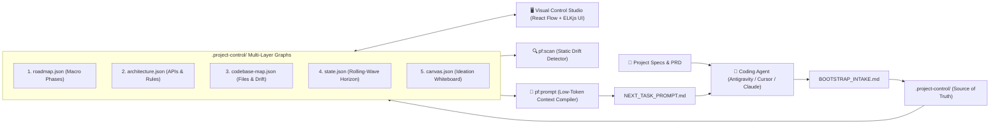

# 🚀 ProjectFlow (`pf`)
> **Visual Architecture, Codebase Intelligence & Rolling-Wave Project Control Toolkit for AI-Assisted Coding**

ProjectFlow (`pf`) is a lightweight, zero-token, framework-agnostic toolkit designed to bring architectural discipline, visual observability, and rolling-wave planning to AI-assisted coding.

Instead of prompting an AI coding agent with 50 pages of raw documentation or letting it create uncoordinated files and drift from intended architecture, ProjectFlow provides a **Single Source of Truth** inside `.project-control/` that is synchronized across **5 Visual Graphs**, **Multi-Agent Rules** (Antigravity, Cursor, Claude Code), and an **Automated Codebase Scanner**.

---



---

## 🔑 Core Philosophy & Architectural Principles

1. **Zero External AI API Keys**: ProjectFlow does NOT call external AI APIs. The coding agent inside your IDE (*Antigravity, Cursor, Claude Code*) IS the intelligence. ProjectFlow provides the deterministic graph control, validator, static scanner, and low-token compiler.
2. **Deterministic Context Bundler**: Compiles only the exact slice of roadmap, module responsibilities, API contracts, rules, and files needed for the current active task into `.project-control/NEXT_TASK_PROMPT.md` (~300–800 tokens instead of 50,000+ tokens).
3. **Rolling-Wave Horizon**: Never generates 100 brittle tasks upfront. It maintains a macro roadmap of phases while generating only 1–3 concrete, atomic tasks for the immediate horizon.
4. **Automated Drift Detection**: `npm run pf:scan` parses physical imports across your codebase (`.js`, `.ts`, `.py`, `.go`, `.php`, `.c`, etc.), flagging unregistered files, layer violations, and module boundary breaches directly in the UI.
5. **Universal Reusability**: ProjectFlow is completely decoupled from any specific business application. Its template directory `.project-control/` is in a clean, blank skeleton state waiting to be dropped into **ANY** target software project.

---

## 📖 Section 1: For Humans (Developer Setup & Workflows)

### 1. Install ProjectFlow into Any Target Project
To add ProjectFlow to an existing repository or new project folder, run:

```bash
# From the ProjectFlow repository:
node scripts/pf-install.mjs /path/to/your-target-project

# Or with force overwrite:
node scripts/pf-install.mjs /path/to/your-target-project --force
```

This automatically:
- Copies clean, blank `.project-control/` templates and validation schemas.
- Installs the Antigravity skill `.agents/skills/project-flow/`.
- Copies `BOOTSTRAP_INTAKE.md` and CLI runner scripts (`scripts/`).
- Bundles the pre-built Visual Control Studio (`ui/dist/`) so you can run the UI immediately without installing React/Vite devDependencies in your target project!
- Adds `pf:*` npm script commands and `zod` to the target project's `package.json`.

---

### 2. Launching the Visual Control Studio
In your project directory, run:

```bash
# Start Visual Control Studio reading .project-control/
npm run pf:ui
```
Open **`http://localhost:4321`** in your browser.

- **Blank Onboarding Screen**: If `.project-control/` is uninitialized, the UI displays a clean banner with a **1-Click Copy Setup Prompt** button to give to your IDE agent.
- **Preview Demo Project**: Test all 5 populated graphs anytime without touching your project files by running:
  ```bash
  npm run pf:ui:demo
  ```
  *(Or click "Preview Demo" directly inside the UI header!)*

---

### 3. The 5 Synchronized Graph Tabs (React Flow + ELKjs Auto-Layout)

| Tab | Model File | Description |
| :--- | :--- | :--- |
| **1. Macro Roadmap** | `roadmap.json` | End-to-end phases/milestones (`planned`, `in_progress`, `completed`, `blocked`), target outcomes, and deliverables. |
| **2. API & Architecture** | `architecture.json` | System modules, API endpoints (with HTTP method badges GET/POST/PUT/DELETE), request/response contracts, and architectural rules. |
| **3. Codebase & File Map** | `codebase-map.json` | File tree and observed dependencies. **Highlights architecture drift** (mismatch between intended and observed roles or forbidden layer imports). |
| **4. Active Tasks** | `state.json` | Current rolling-wave horizon tasks, order badges, statuses (`ready`, `in_progress`, `done`), and acceptance criteria. |
| **5. Ideation Canvas** | `canvas.json` | Freeform whiteboard for sticky notes and proposals. Node positions auto-save to disk on drag stop (`onNodeDragStop`). |

- **Two-Way Editing**: Click any node in any graph to open the **Right-Hand Inspector Drawer** to edit fields, change status, add deliverables, or delete nodes directly back to JSON.
- **Agent Command Bar**: Floating dock with 1-click buttons to copy ready-to-paste instructions for the IDE agent (*Plan Next Task*, *Context Bundle*, *Drift Audit*, *Sync Rules*, *Reset*).

---

### 4. Codebase Static Scanner & Drift Detector

```bash
# Inspect actual source code on disk against architecture rules:
npm run pf:scan

# Automatically register discovered files into codebase-map.json:
npm run pf:scan -- --fix
```

The scanner parses actual imports (`import`, `require`, `from ... import`, `#include`, etc.) and detects:
- **Unregistered Files**: Source files created during coding not yet cataloged in `codebase-map.json`.
- **Missing Files**: Registered files that were deleted or moved.
- **Layer & Boundary Violations**: A `core` module importing a `ui` module, or a module importing another module without an explicit dependency declaration.

---

### 5. CLI Command Reference

| Command | Action |
| :--- | :--- |
| `npm run pf:status` | Shows initialization state, macro roadmap milestone progress, and active tasks. |
| `npm run pf:ui` | Starts the Visual Control Studio server on `http://localhost:4321`. |
| `npm run pf:ui:demo` | Starts the Visual Control Studio previewing `templates/example-project/`. |
| `npm run pf:scan` | Scans physical repository files and reports architectural drift. |
| `npm run pf:validate` | Validates all `.project-control/*.json` files against strict Zod schemas and cross-referenced IDs. |
| `npm run pf:prompt [taskId]` | Deterministically compiles `.project-control/NEXT_TASK_PROMPT.md` for the active task. |
| `npm run pf:complete <taskId> -- -s "..."` | Marks task completed, logs git diff & file roles, and prepares rolling-wave horizon for the next task. |
| `npm run pf:sync-rules` | Exports architectural rules to `.cursorrules`, `CLAUDE.md`, and `.agents/rules/`. |
| `npm run pf:reset` | Resets `.project-control/` back to clean, blank skeleton templates (`"initialized": false`). |

---

## 🤖 Section 2: For AI Agents (`Quick Start Prompt`)

When bootstrapping a new or existing repository with an AI coding agent (*Antigravity, Cursor, Claude Code*), paste this **exact 2-line prompt** into the chat alongside your project specification or documentation:

> ```text
> Read BOOTSTRAP_INTAKE.md and .agents/skills/project-flow/SKILL.md.
> Analyze our project docs and initialize ProjectFlow (.project-control/) with our Macro Roadmap, API Structure, Architecture Rules, and initial rolling-wave tasks.
> ```

### What the AI Agent Does Next (Autonomous Intake Protocol)
1. **Reads Intake Rules**: Reads [`BOOTSTRAP_INTAKE.md`](file:///d:/Programing/PF-ProjectFlow/BOOTSTRAP_INTAKE.md) and [`.agents/skills/project-flow/SKILL.md`](file:///d:/Programing/PF-ProjectFlow/.agents/skills/project-flow/SKILL.md).
2. **Hydrates `.project-control/`**:
   - `roadmap.json`: Populates 3–6 high-level phases with target outcomes and deliverables.
   - `architecture.json`: Extracts modules, layers (`core`, `server`, `ui`, `cli`), REST API endpoints with request/response schemas, and guardrail rules.
   - `state.json`: Sets `"initialized": true`, sets `activeMilestoneId: "M1"`, and generates **only the first 1–2 concrete tasks** for `activeTasks`.
   - `codebase-map.json`: Catalogs planned initial files and roles.
3. **Validates State**: Runs `npm run pf:validate` to ensure zero schema violations.
4. **Compiles Prompt**: Runs `npm run pf:prompt` to produce `.project-control/NEXT_TASK_PROMPT.md`.
5. **Executes & Advances Rolling-Wave**:
   - Executes code according to acceptance criteria.
   - Updates `codebase-map.json`.
   - Runs `npm run pf:complete TASK-01 -- --summary "Implemented core logic"`.
   - Generates `TASK-02` from `roadmap.json` (Mode 1: Rolling-Wave Planner).

---

## 📂 Repository File Structure

```text
PF-ProjectFlow/
├── .agents/
│   └── skills/
│       └── project-flow/          # Antigravity skill instructions & reference docs
│           ├── SKILL.md           # 5 operational modes (Planner, Finisher, Sync, Drift, Bootstrap)
│           └── references/        # Architecture rules & intake guides
├── .project-control/              # Clean blank template state (Single Source of Truth)
│   ├── state.json                 # Project metadata & active rolling-wave tasks
│   ├── roadmap.json               # Macro milestones & phase dependencies
│   ├── architecture.json          # System modules, API contracts & guardrails
│   ├── codebase-map.json          # File registry & observed drift flags
│   ├── canvas.json                # Ideation whiteboard nodes & edges
│   ├── activity.jsonl             # Immutable audit trail
│   └── schemas/                   # Official JSON schemas
├── templates/
│   ├── blank/                     # Pristine uninitialized skeleton templates
│   └── example-project/           # Fully populated reference demo (TaskForge)
├── scripts/
│   ├── pf-cli.mjs                 # Unified CLI command router
│   ├── ui-server.mjs              # Local two-way API server & static SPA host
│   ├── pf-scan.mjs                # Multi-language static scanner & drift auditor
│   ├── pf-install.mjs             # Target-project setup & installer
│   ├── validate-control.mjs       # Cross-referenced schema validator
│   └── schemas.mjs                # Zod validation schemas
├── ui/                            # Visual Control Studio (React Flow + ELKjs)
│   ├── src/                       # Custom nodes, inspectors, command bar, & layout
│   └── dist/                      # Pre-built production bundle
├── BOOTSTRAP_INTAKE.md            # Agent intake protocol for target repositories
├── package.json                   # Toolkit scripts & dependencies
└── README.md                      # Comprehensive user & agent guide
```

---

## 🛡 License
MIT License. Free to use, adapt, and bundle into any AI-assisted workflow or software repository.
